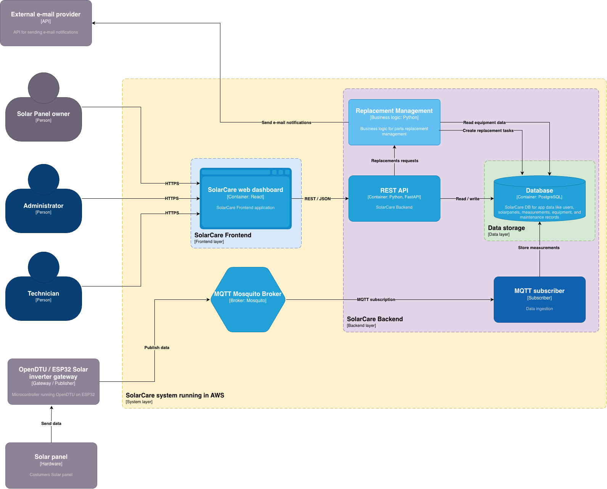

# SolarCare

## What this README contains

This README gives the overview of what SolarCare is, who uses it, and how the processes work.
For more detail, the diagrams and ADR files are linked below: the [C4 diagrams](#software-architecture-c4) show the system from wide to detailed, the [sequence diagrams](#uml-sequence-diagrams) show how the incident and health check processes run, and the [ADRs](#architecture-decisions) give the reasons and deep technical overview behind the design.

## What is SolarCare?
The terms used in these docs are defined in the [Glossary](docs/glossary.md).

**SolarCare is support software for private house owners in Germany.** It monitors, collects readings, manages incidents and health checks for the solar system, and keeps the record of what is installed and its health.

The system monitoring can include:

- Solar panels
- Inverters or microinverters
- Power optimizers, where installed
- Batteries, where installed
- Energy meters and monitoring gateways
- Cables and connectors
- Relevant electrical protection components

## Important notes

**Inspection interval:** German guidance recommends a full-system inspection every four years. SolarCare may set a shorter interval under its maintenance policy.

**New solar systems:** A solar system is registered in SolarCare before its readings are used. The inverter serial number is linked to the owners home. Readings from an unknown serial number are not added to any home.

**Customers and incidents:** The customer, incident, health check, visit and part records are kept in the company CRM (Salesforce), which also tracks the SLA on each case. Users never open the CRM. They work in SolarCare, which checks their role and sends every change to the CRM. SolarCare stores only the customer ID, reads the cases back, and shows each role the data it is allowed to see.

## Who takes part in monitoring and maintenance

- **Solar System owner:** sees their own system and can raise an incident case if they find an issue with their solar system.
- **Support engineer:** investigates the incident remotely. They can also see a system trigger about a possible issue, even if the owner has not reported it, and they open a proactive incident.
- **Support team lead:** chooses the next step. They can approve an on-site technician visit with no CFG involved, when the physical issue is already clear. Or they can approve a transfer to CFG, when a deeper software or data investigation is needed.
- **CFG (software engineer):** investigates after that transfer. If it is a software bug, they fix it. If it turns out to be hardware, they assign the regional technician.
- **Regional technician company:** uses SolarCare only for incidents assigned to it in its area of Germany. The visit and the full hardware process stay on their side.

## Levels of support, their responsibility and SLAs

Priority definitions: P1 – Critical, P2 – High, P3 – Normal, P4 – Low.

| Level | Name | Responsibility | Response SLA | Resolution SLA |
|---|---|---|---|---|
| **L0** | Self-service support | Provides answers to common questions and basic troubleshooting. Unresolved issues go to L1 | No individual response SLA | Self-Service |
| **L1** | Support Engineer| First-line support and remote investigation. | P1: 1 hour; P2: 4 hours; P3: 1 business day; P4: 2 business days | P1: 2 business days; P2: 5 business days; P3: 10 business days; P4: 5 business days |
| **L2** | Engineer (CFG) | Second-line technical and software support. | Follows incident priority SLA | P1: 2 business days; P2: 5 business days; P3: 10 business days; P4: 5 business days |
| **L3** | External Technician | On-site hardware inspection and repair. | According to partner SLA | According to partner SLA and parts availability |

## System processes

The steps live in `diagrams/sequence`. This list only names the processes.

- **Incident.** An owner report, or a proactive incident from a system trigger. SolarCare opens it as a case in the CRM, from a template. Support investigates remotely. The team lead then either approves an on-site visit with no CFG, when the physical issue is already clear, or approves a transfer to CFG for a deeper software investigation.
- **Scheduled health check.** An agreed date or interval opens a check, not a replacement. The technician replaces a part only if the visit says so.
- **Management access.** The management team can see aggregated information for all systems, or for a subset. That view supports business processes such as planning, partnerships, and reporting. It is not an incident. Raw data is only if needed. There is no sequence for this yet.
- **Registering a new solar system.** The regional technician installs Solar panels system. If the owner wants monitoring, the technician registers the system in SolarCare using the website on their phone, and links the inverter serial number to the owner's home. The owner is already a customer in the CRM, because they paid for the system. The owner then gets access through the website, and can raise incidents and see their data. Readings from an unknown serial number are not added to any home. There is no sequence for this yet.

### Initial scope

SolarCare initially focuses on **monitoring and incident support for private houses**, including the scheduled health check. SolarCare is not a warehouse or parts management system. The regional technician firm handles the physical work and the parts.

## Software architecture (C4)

The following section shows the parts of SolarCare and how they connect, from the whole system down to the inside of the API.

### Architecture overview

- [Context](diagrams/c4/SolarCareContextC4.png)
- [Containers](diagrams/c4/SolarCareContainerC4.png)
- [API components(?)](diagrams/c4/component.md)

## UML sequence diagrams

This shows step by step who does what, and in what order, in each process. In every sequence below, users work in SolarCare. 

- [Incident: FAQ and the customer's software](diagrams/sequence/incident-faq-sequence.md)
- [Incident: software engineer](diagrams/sequence/incident-software-sequence.md)
- [Incident: hardware already clear](diagrams/sequence/incident-hardware-sequence.md)
- [Scheduled health check](diagrams/sequence/health-check-sequence.md)

## Architecture decisions

The architecture decisions are in the `adr` folder. An ADR (architecture decision record) is a short file that records one design decision, why we made it, and what it changes. Each ADR follows Michael Nygard's format: Status, Context, Decision and Consequences, plus an Open questions section, as this is ongoing project.

- [Technology stack](adr/technology-stack.md): the tools SolarCare uses, where each one runs, and why it was chosen.
- [Interfaces](adr/interfaces.md): each connection between the gateway, broker, API, database and website, what happens when one fails.
- [Data collection](adr/data-collection.md): which readings and customer details are collected, and which are never collected.
- [Data security](adr/data-security.md): who may see which data, who may act on it, and how access is protected.
- [Availability](adr/availability.md): the internal 99.5% SLA target, which parts need redundancy, and what happens when readings stop.
- [Logging](adr/logging.md): which events are logged, what must not be logged, and who can read the logs.
- [GDPR](adr/gdpr.md): roles, legal basis, hosting, retention, owner rights and data breaches.
- [DPIA](docs/dpia.md): the data protection impact assessment, its risks and measures.

Architecture diagram - Boris B

Stakeholders & Market
## Stakeholder Analysis

### External Stakeholders

| Stakeholder | How they are affected / affect us | Interest | Power | Attention | Data access |
|---|---|---|---|---|---|
| **Private customers** | Use and pay for the software; protect & monitor their PVs. Creating a ticket for replacement & connecting them to the right replacement company. | High | High | Manage closely | Own data only; can export, delete and share (GDPR-compliant). |
| **Inverter manufacturers** | Our data source via their API; can block access; can compete with their own apps. | Medium | High | Manage closely | Receive no data |
| **Third-party replacement company** | Carry out repairs. We connect them with our platform through third-party partnerships. | High | Medium | Manage closely | System data + customer data, per ticket only. |
| **Government / regulator / BfDI & Federal Network Agency** | Sets rules (subsidies, grid, data law). We might provide them aggregated data for governmental reporting. | Low | High | Keep satisfied | Aggregated data only. |
| **Cloud / software providers** | Host and process our data – using their service only. | Medium | Medium | Keep informed | Technical processing under a data processing agreement. |
| **Competitors** | Influence pricing and positioning in the market. | Medium | Medium | Monitor | None |

### Internal Stakeholders

| Role | Responsibility | Interest | Power | Attention | Data access |
|---|---|---|---|---|---|
| **Founders / management** | Strategy, finance, partnerships with replacement companies & data protection. | High | High | Manage closely | All data in aggregated form; raw data only if needed. |
| **Software engineers** | Build the platform, connect inverter APIs, forecasting & designing models. | High | Medium | Manage closely | Anonymised or test data; live data only for incidents, logged. |
| **Support engineer** | Handles tickets, coordinates installers.  **Support levels:** • **L0 – Self-service:** FAQ and help center. • **L1 – Basic support:** General questions and account issues. • **L2 – Technical support (software engineer):** Technical issues connected to our software. • **L3 – Physical support:** Assign to a third-party replacement company. | High | Medium | Keep informed | Only customers with an open ticket |
| **Marketing / GTM & sales** | Customer acquisition/growth, installer partnerships. | Medium | Low | Keep informed | Opt-in contact data + anonymised aggregated analytics; no system data. |
