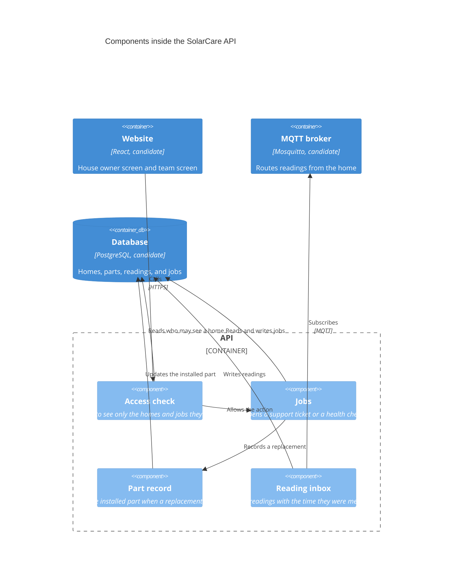

# SolarCare component diagram

C4 level 3. This opens the API only. The website, the broker, and the database stay as neighbors. The modules below are parts of the API. They are not separate programs.

Arrows show who starts the communication.

A support ticket or a health check becomes a job. The part record changes only when that job says a part was replaced. The reading inbox does not decide that a part has failed.
