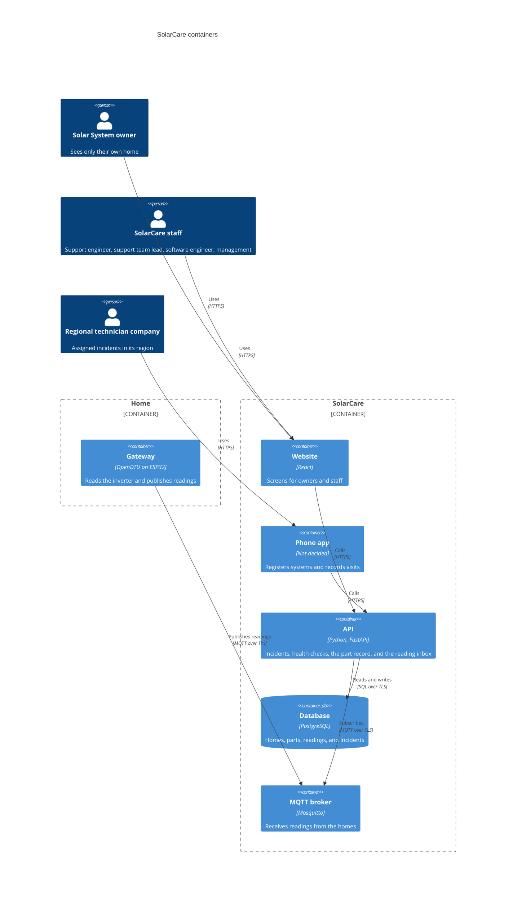

# SolarCare container diagram

C4 level 2. This opens the SolarCare box into the website, the phone app, the API, the database, and the MQTT broker. A container here means a program or a data store that runs on its own. It does not mean a Docker container.

Arrows show who starts the communication.

The gateway stays in the home. The website and the phone app do not connect to the broker or the database. There is no line from the gateway straight to the database. The API subscribes to the broker, so the broker is not the side that opens that connection.

## Who can see what

| Role | Uses | Sees |
| --- | --- | --- |
| Solar System owner | Website | Own home only |
| Support engineer | Website | Homes with an open incident |
| Support team lead | Website | Incidents waiting for approval |
| Software engineer (CFG) | Website | One home, after an approved transfer |
| Regional technician company | Phone app | Assigned incidents in its region |
| Management | Website | Anonymised totals |

The full rules are in [Data security](../../adr/data-security.md). What is collected is in [Data collection](../../adr/data-collection.md). The terms are defined in the [Glossary](../../docs/glossary.md).
