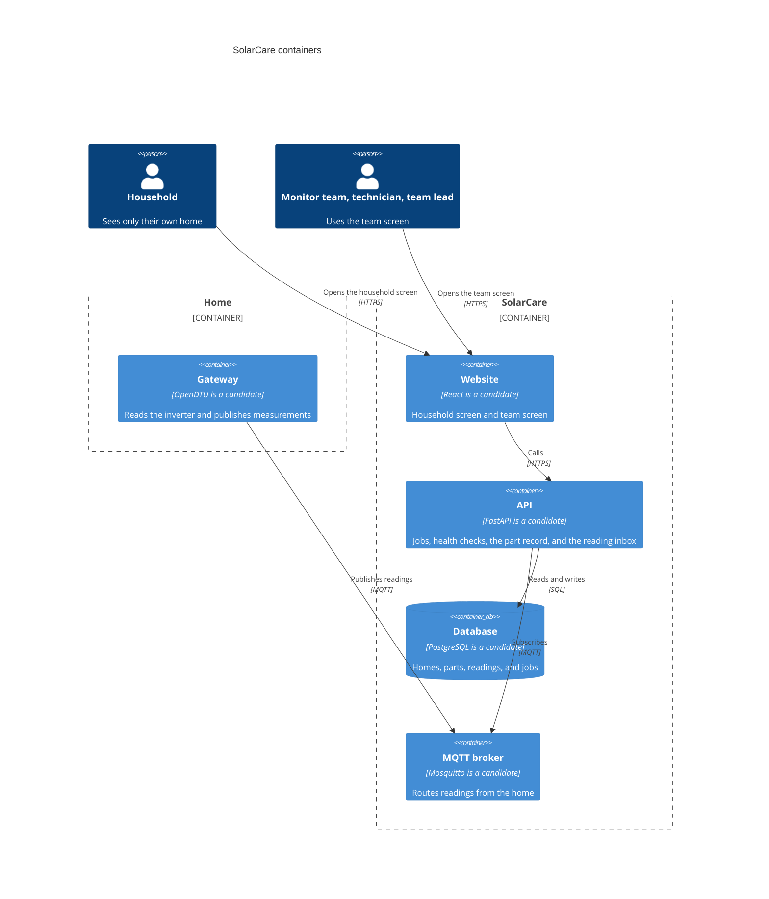

# SolarCare container diagram

C4 level 2. This opens the SolarCare box into the website, the API, the database, and the MQTT broker. A container here means a program or a data store that runs on its own. It does not mean a Docker container.

Arrows show who starts the communication. Technology names are candidates, not final choices.

The gateway stays in the home. The household screen does not connect to the broker. There is no line from the gateway straight to the database. The API subscribes to the broker, so the broker is not the side that opens that connection.

## Who can see what

| Role | Data they can see | What they can do |
| --- | --- | --- |
| Household | Their own numbers, the measurement time, and their job status | Open a report. They cannot open the fuller log. |
| Monitor team | Readings and jobs for the homes in their scope | Open a job |
| Technician | The assigned job and the log attached to it | Record the visit and the new part |
| Team lead | The job that needs an unusual approval | Approve or refuse |

What is taken from the house: power, daily energy, temperature, whether the inverter is reachable, and the time of the measurement. A fuller log is stored only when a report is sent, and only the team can read it. Name, address, and which home it is are personal data.
