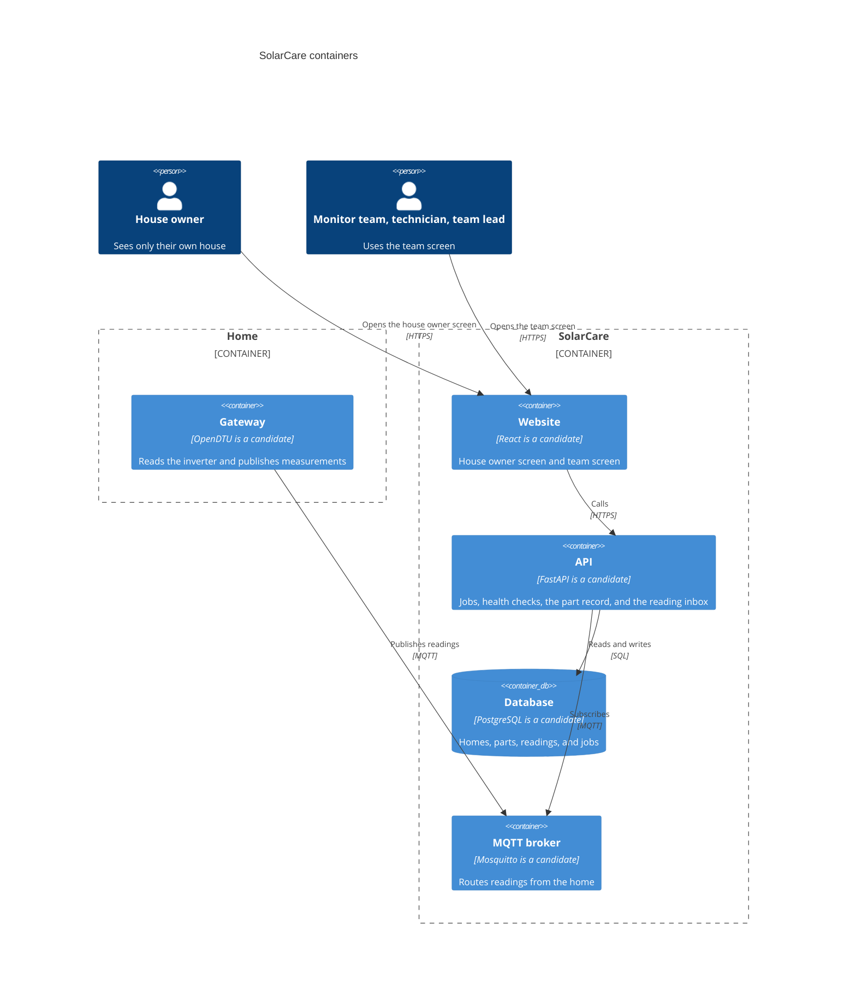

# SolarCare container diagram

C4 level 2. This opens the SolarCare box into the website, the API, the database, and the MQTT broker. A container here means a program or a data store that runs on its own. It does not mean a Docker container.

Arrows show who starts the communication. Technology names are candidates, not final choices.

The gateway stays in the home. The house owner screen does not connect to the broker. There is no line from the gateway straight to the database. The API subscribes to the broker, so the broker is not the side that opens that connection.

## Who can see what

| Role | Uses | Sees |
| --- | --- | --- |
| Solar System owner | Website | Own home only |
| Support engineer | Website | Homes with an open incident |
| Support team lead | Website | Incidents waiting for approval |
| Software engineer (CFG) | Website | One home, after an approved transfer |
| Regional technician company | Phone app | Assigned incidents in its region |
| Management | Website | Anonymised totals |

The full rules are in [Data security](../../adr/data-security.md).

What is taken from the house: power, daily energy, temperature, whether the inverter is reachable, and the time of the measurement. A fuller log is stored only when a report is sent, and only the team can read it. Name, address, and which home it is are personal data.
