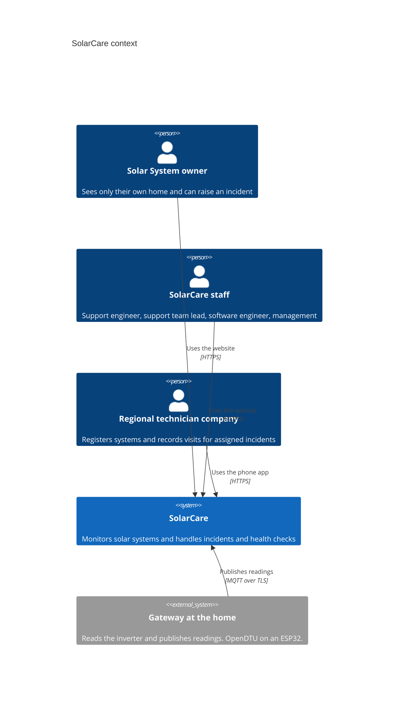

# SolarCare context diagram

C4 level 1. SolarCare is one box. Arrows show who starts the communication. The gateway stays outside SolarCare, at the home.

The terms are defined in the [Glossary](../../docs/glossary.md).
