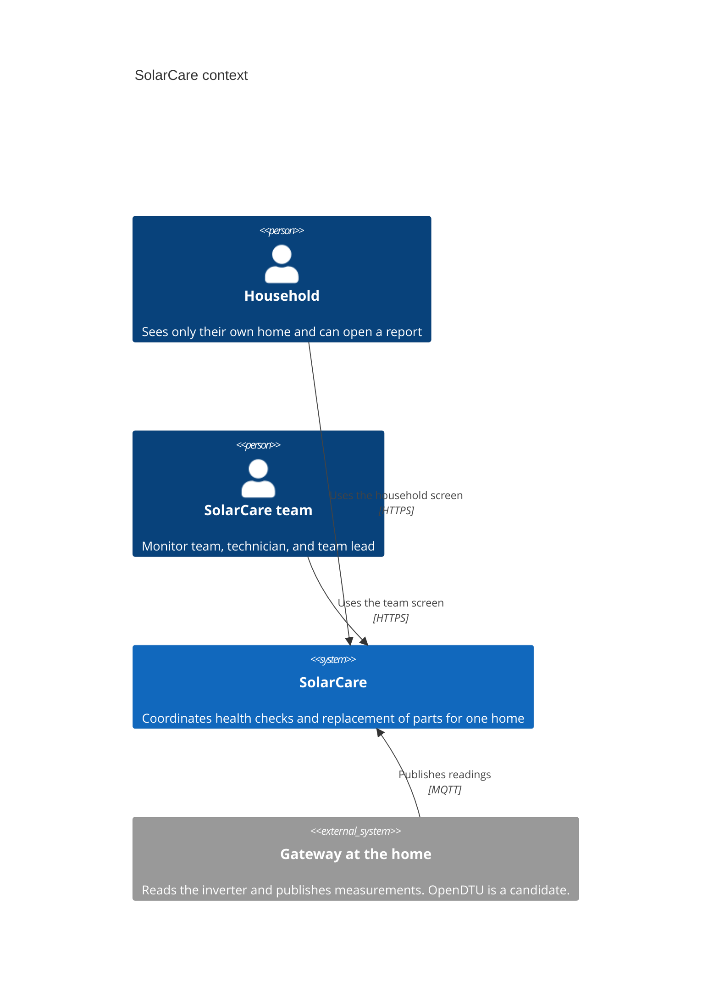

# SolarCare context diagram

C4 level 1. SolarCare is one box. Arrows show who starts the communication. The gateway stays outside SolarCare, at the home.

Email and a supplier system are not on this picture. They are not part of the current design.
