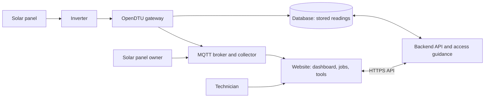

# SolarCare — working diagram

Captured from the team sketch. The boxes below match that sketch. The stakeholder list and the lost-connection notes were written beside it.

The sketch labels OpenDTU as the gateway. That is the gateway drawn here, not a decision that every installation must use OpenDTU.

## Diagram

The owner arrow is drawn to the MQTT broker and is not labeled on the sketch. The technician is drawn to the website. The website and the database both connect to the backend. The link between the website and the backend is marked HTTPS API.

## Who can see what

| Stakeholder | Information they may see | Decisions |
| --- | --- | --- |
| Small private customer | Their own data, if they choose to look | Their own installation only |
| Government | Aggregated data, with no identifiable customer | Not specified |
| Supplier | Software and hardware information only | No customer information |
| Logistics | Software and hardware information only | No customer information |
| Support engineer | Data for their own region | Their own region only |
| Software engineer | Data for their own region | Their own region only |
| Marketing | No customer data | No customer data |
| Management | Their own region | Their own region only |
| Top management | All companies' data | Not specified |
| Third-party users | Not specified | Not specified |

The backend is the place these limits are applied. The sketch calls that part of the backend "access guidance."

## When the internet connection is lost

The panels keep producing power if the website is offline. A proposal, not a confirmed OpenDTU feature: the gateway stores readings locally, limited by time and by how much it has stored. When the connection returns, it sends the stored readings oldest first.

The website shows the latest reading it has, and the time the reading was measured. A reading sent later can arrive now and still be old. If readings stop, the page says the data is out of date. A check tells the user whether the system is responding.

Still open on the sketch:

- How much data the device can store.
- How retries avoid duplicate readings after reconnecting.
- Low output is not treated as dirty panels.
- No external weather API in this version.
