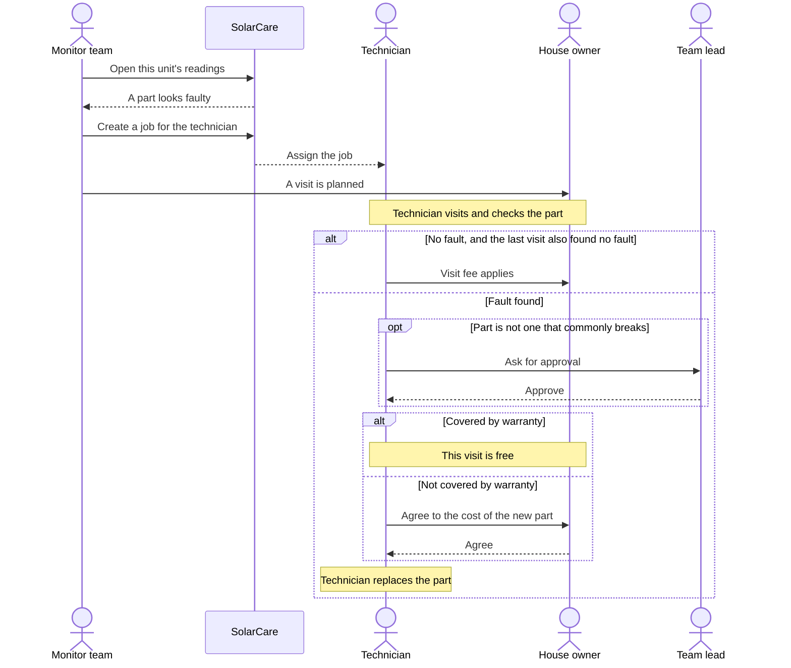

# Faulty part: the monitor team starts the job

The monitor team sees a reading that a part looks faulty. They create a job for a technician, then tell the house owner.

This is a UML sequence for one corrective case. It does not show the website talking to the API.

Still to check with the team: if the part is one that commonly breaks, can the technician start the replacement with no team lead?

Proposed team policy, still to be agreed: the visit is free when the fault is under warranty, and a visit fee applies after two visits in a row with no fault.

In this drawing the team lead is asked before the house owner is asked to pay.
