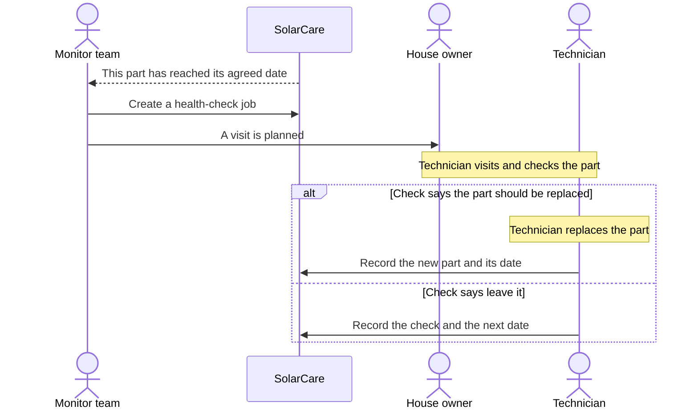

# Agreed date: the monitor team starts the health check

This job exists only for a part that has its own agreed date on the record. The date comes from that model's maker guidance or from the policy agreed with the house owner. There is no one number of years for every solar part.

The years and warranty lengths below are proposals to check. They are not rules we have confirmed.

IEC 62446-2 (in Germany, DIN EN 62446-2) says to follow the manufacturer. It does not set a replacement year. For a private home in Germany there is also no general law that says parts must be swapped on a calendar. Insurers often ask for a yearly look and an electrical check about every 4 years (DIN EN 62446-1). Those are inspections. They are not the same as replacing a part because a date arrived.

| Part | Agreed replacement date? |
| --- | --- |
| String inverter | Yes, when that model has a service life or warranty end. Often talked about as 10 to 15 years. Warranties are often 5 to 10 years. Store the date for that unit, not one date for all inverters. |
| Battery | Yes, when the maker gives a year, a cycle count, or a capacity limit. A 10-year warranty is common. Whichever limit is reached first. |
| Inverter filter, and other parts the manual tells you to swap on a schedule | Yes. Use the manual. |
| Surge protector | Only if that device's manual gives a maximum time. Otherwise replace when its indicator says end of life, or after a strike. |
| Panels | No. A performance warranty of about 25 to 30 years is a promise about output, not an order to replace the panel on that birthday. Replace when it is damaged or below the promised output. |
| Cables, connectors, mounting | No. Inspect them. Replace when the inspection says so. |
| Microinverters and optimizers | No short agreed date. Warranties are often 20 to 25 years. Use the manual for that model if it names a date. |

This is a UML sequence for the preventive case: a date opens a health check, not a replacement.

A replacement happens only when the check says so. An incident at the house follows the incident sequences. This scheduled check does not.
