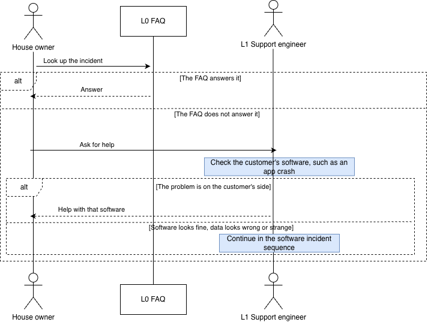

# Incident: FAQ and the customer's software

An incident is an unplanned problem at a private house. L0 is the FAQ. L1 is a support engineer.

This is a UML sequence for the first step. It does not show the website talking to the API. If the software looks fine and the data looks wrong, the case continues in [incident-software-sequence.md](incident-software-sequence.md). A case that is already known to be hardware starts in [incident-hardware-sequence.md](incident-hardware-sequence.md).

How to read it:

- Read from top to bottom. The names repeated at the bottom are the same people, not a second group.
- A solid arrow is a request. A dashed arrow is the reply.
- A dotted box marked **alt** is a choice. Only one of the bracketed cases happens.
- A yellow note is a reminder on that step. It is not a message to another person.

