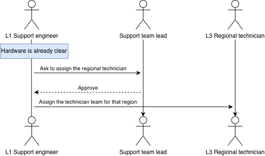

# Incident: hardware already clear

Support already knows this incident is hardware. The evidence comes from monitoring, or from the house owner, such as a photo of a broken cable. The support team lead approves, and L1 assigns the third-party technician for that region. The software engineer is not in this path.

This is a UML sequence for that step.

How to read it:

- Read from top to bottom. The names repeated at the bottom are the same people, not a second group.
- A solid arrow is a request. A dashed arrow is the reply.
- A dotted box marked **alt** is a choice. Only one of the bracketed cases happens.
- A blue note is a reminder on that step. It is not a message to another person.

If the support team lead does not approve, the incident stays with L1.
