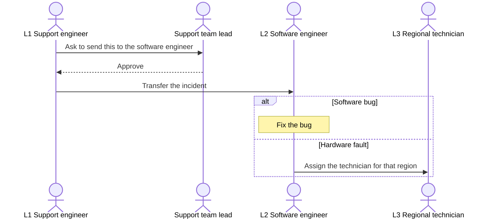

# Incident: software engineer

This starts after L1 has checked the customer's software. The software looks fine, and the data looks wrong or strange. L2 is a software engineer (CFG). The support team lead approves the transfer.

This is a UML sequence for that step. If L2 finds a hardware fault, the case goes to the third-party technician for that region.

How to read it:

- Read from top to bottom. The names repeated at the bottom are the same people, not a second group.
- A solid arrow is a request. A dashed arrow is the reply.
- A dotted box marked **alt** is a choice. Only one of the bracketed cases happens.
- A yellow note is a reminder on that step. It is not a message to another person.

If the support team lead does not approve, the incident stays with L1.
