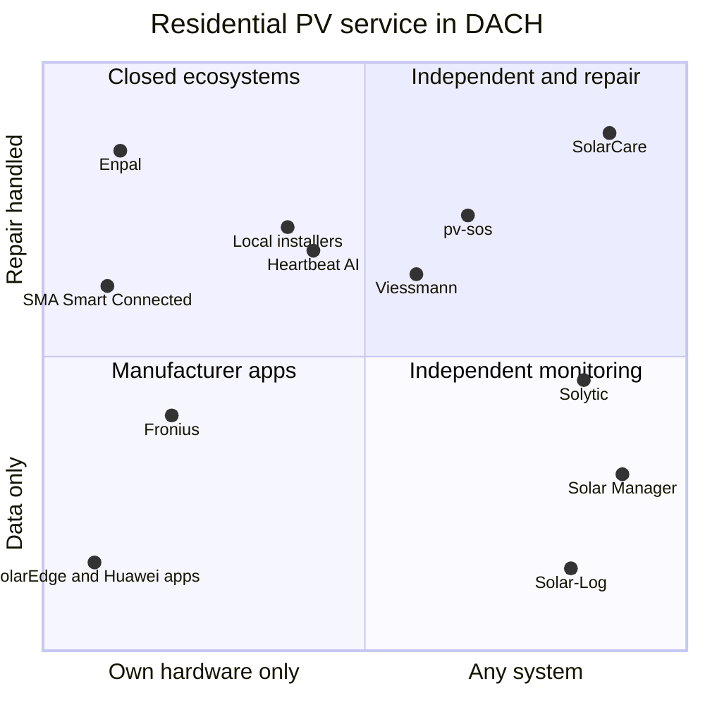

## Competitor Analysis

SolarCare competes with three groups: 
 
**1. manufacturers** that service their own inverters, 
 
**2. residential service providers** that offer maintenance or monitoring to homeowners, and 
 
**3. utility-scale O&M companies** that become relevant once SolarCare expands to larger systems.
 

### Competitive Positioning (Residential, DACH)

### 1. Manufacturer Service Programs (direct, own hardware only)

| Company | Offering | Price | Weakness vs. SolarCare |
|---|---|---|---|
| **SMA – Smart Connected** | Automatic 24/7 inverter monitoring; informs owner and installer; ships a replacement inverter within 1–3 days | Free | SMA inverters only; covers the inverter, not the whole system |
| **Fronius – Solar.web** | Monitoring app, alerts, Service Partner program for installer repairs, 10-year warranty after registration | Free; Premium approx. €24/year | Fronius inverters only; repair depends on the installer |
| **SolarEdge, Huawei, Enphase** | Free monitoring apps with error codes | Free | Own hardware only; error codes without instructions; no repair coordination |

### 2. Residential Service Providers (direct competitors)

| Company | Type | Offering | Price | Weakness vs. SolarCare |
|---|---|---|---|---|
| **Enpal** | Installer with service subscription | Remote maintenance, monitoring, repairs | €5/month (2 years), then €20/month | Own customers only |
| **1KOMMA5° – Heartbeat AI** | Energy manager + own technicians | Energy optimisation, dynamic tariffs; retrofit for third-party systems since Nov 2025 | Gateway + tariff | Focus on energy trading, not fault prediction |
| **Solar Manager AG** (CH) | Home energy management system | Manufacturer-independent monitoring, fault analysis and remote access for installers; >20,000 customers, market leader in Swiss residential | Hardware + annual licence | Focus on self-consumption; sold via installers; no repair coordination |
| **Solytic** (Berlin) | Independent AI monitoring | Manufacturer-independent monitoring, service marketplace | Via partners (B2B2C) | Sold mainly through installers/utilities; weak consumer brand |
| **Solar-Log** | Data logger + portal | Cross-manufacturer monitoring | Hardware purchase | Data only, no repair service |
| **pv-sos GmbH** | Independent PV service company | Maintenance and repairs for private owners | On request | Manual, on-site; no continuous data analysis |
| **Viessmann** | Heating/energy brand | PV maintenance via partner network | On request | Periodic checks, not predictive |
| **Local installers** | Maintenance contract | On-site check every 1–4 years | €150–300/year | Reactive, no live data, limited capacity |

### 3. Utility-Scale & C&I O&M Providers (indirect, relevant for expansion)

| Company | HQ | Focus | Relevance for SolarCare |
|---|---|---|---|
| **ENcome Energy Performance** | Klagenfurt, AT | Independent O&M for PV plants in Europe and Australia; 24/7 monitoring center; ~90 employees | Competitor in phase 3 (large systems) |
| **BELECTRIC** | Kolitzheim, DE | Utility-scale O&M, thermography, voltage inspections, 24/7 monitoring | Competitor in phase 3 |
| **GOLDBECK SOLAR** | Hirschberg, DE | Commercial and utility O&M, repowering | Competitor in phase 3 |
| **JUWI** | Wörrstadt, DE | Development and O&M of large solar and hybrid plants | Competitor in phase 3 |
| **ABO Energy** | Wiesbaden, DE | Operations management for >2,200 MW renewable assets | Competitor in phase 3 |
| **TSG Solar** | DACH | C&I maintenance, compliance audits | Competitor in phase 3 |
| **SPR Energie** | North Germany | Regional installer, >500 MWp under maintenance | Competitor in phases 2–3 |
| **NovaSource Power Services** | Global | World's largest O&M provider (38.4 GW) | No residential business |
| **meteocontrol, Solargis** | DE / global | AI monitoring for large plants | Too complex and expensive for homes |

### SolarCare's Differentiation

| Feature | Manufacturer apps | Enpal / 1KOMMA5° | Independent monitoring | Local installers | **SolarCare** |
|---|---|---|---|---|---|
| Works with any inverter brand | ❌ | ❌ | ✅ | ✅ | ✅ |
| Continuous data monitoring | ✅ | ✅ | ✅ | ❌ | ✅ |
| Predicts failures before they happen | ❌ | ❌ | Partly | ❌ | ✅ |
| Plain-language diagnosis for owners | ❌ | Partly | ❌ | ✅ | ✅ |
| Coordinates the repair | Inverter only (SMA) | ✅ | ❌ | ✅ | ✅ |
| Focus on private customers | ✅ | ✅ | ❌ (B2B2C) | ✅ | ✅ |

### Industry Insights from Leading Research

| Source | Key insight | Relevance for SolarCare |
|---|---|---|
| **McKinsey (2026)** – Renewables O&M reimagined | Renewables operators face profitability pressure; better O&M and AI-driven maintenance are now key levers to improve returns on existing assets instead of only building new capacity | Confirms the shift from new installations to the installed base |
| **McKinsey** – Predictive maintenance research | Predictive maintenance typically reduces downtime by 30–50% and extends asset life by 20–40% | Quantifies the value of predicting failures early |
| **BCG (2025)** – Energy Management Systems | Home and building energy management systems are becoming a key element of Europe's energy transition; EMS influences €600–850 bn across European energy markets; names 1KOMMA5° as a key player | Shows the strategic value of the home-energy data layer |
| **Roland Berger** – Predictive maintenance | Global predictive maintenance market grew 20–40% per year; success depends on a service mindset, not only on sensors and analytics | Supports a service-led model (diagnosis + repair), not just a dashboard |
| **Kearney** – Wired for performance | Traditional O&M approaches fall short as renewables scale; digital-led O&M and skilled-workforce shortages are key challenges | Supports remote diagnosis to save technician time |
| **Wood Mackenzie (2026)** – Global Solar PV O&M | O&M market reached 348 GW; top 15 providers control 57% | Large players focus on utility-scale; residential remains fragmented |
| **Berg Insight** – Home Energy Management Systems | ~2.2 m HEMS installed in European homes; penetration only ~1.8%; Germany is more than half of the European market | Smart home-energy services are still at an early stage → low saturation |
| **Center for Sustainable Transformation** – Solarmonitor | The European B2C PV market has no truly dominant player | Room for a new independent brand |
| **IEA PVPS Task 13** – PV Failure Fact Sheets 2025 | Documents the most important PV failure types, their risks and how to prevent them; targeted at installers, investors and insurers | Technical basis for SolarCare's fault-detection rules |
| **Fraunhofer ISE** – Degradation in PV Power Plants | Inverter failures are the most frequent cause of larger yield fluctuations; almost all yield losses are repairable | Validates the focus on inverters and early repair |

### Sources

**Consulting & market research**
- [McKinsey – Renewables O&M reimagined (2026)](https://www.mckinsey.com/industries/electric-power-and-natural-gas/our-insights/renewables-o-and-m-reimagined-boosting-performance-with-ai-and-conventional-levers)
- [McKinsey – Manufacturing: Analytics unleashes productivity and profitability](https://www.mckinsey.com/capabilities/operations/our-insights/manufacturing-analytics-unleashes-productivity-and-profitability)
- [BCG – Energy Management Systems (2025)](https://web-assets.bcg.com/4c/64/be48ec324876a7fee51f64241110/bcg-energy-management-systems.pdf)
- [Roland Berger – Predictive maintenance](https://www.rolandberger.com/publications/publication_pdf/roland_berger_predictive_maintenance_2018.pdf)
- [Kearney – Wired for performance: digital-led O&M in renewable energy](https://www.kearney.com/documents/d/asset-library-291362522/wired-for-performance-unlocking-digital-led-oandm-excellence-in-renewable-energy-pdf)
- [Wood Mackenzie – Global Solar PV O&M (2026)](https://www.woodmac.com/press-releases/global-solar-pv-om-market-reaches-348-gw-as-consolidation-tightens-and-costs-fall/)
- [Berg Insight – Home Energy Management Systems Market](https://media.berginsight.com/2024/09/13231632/bi-homeenergy2-ps.pdf)
- [pv magazine – Solarmonitor: European B2C PV market (2026)](https://www.pv-magazine.com/2026/07/06/european-b2c-photovoltaic-market-lacks-truly-dominant-players/)

**Research institutes**
- [IEA PVPS – Photovoltaic Failure Fact Sheets 2025](https://iea-pvps.org/key-topics/photovoltaic-failure-fact-sheets-2025/)
- [Fraunhofer ISE – Degradation in PV Power Plants](https://publica.fraunhofer.de/handle/publica/405674)
