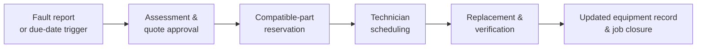
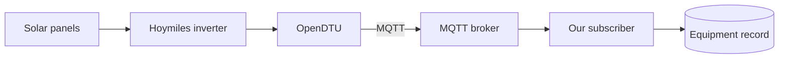
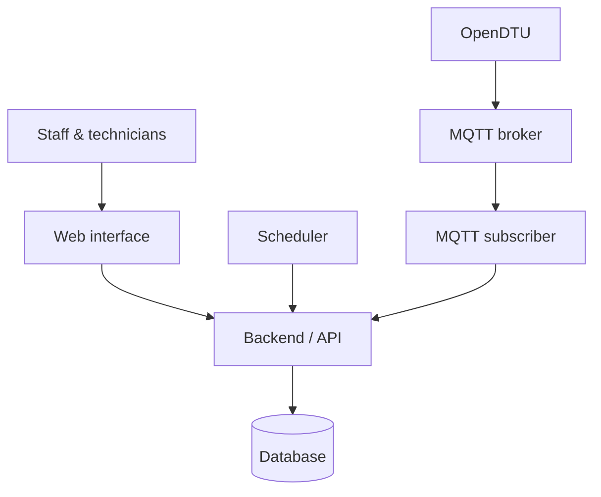

# ☀️ Solar Component Replacement

**Solar Inc · Replacement Management**
Business concept & software architecture · MTM 03.1 · 6 October 2026

> Small initial design, clear responsibilities and room to grow.

---

## 📑 Table of Contents

1. [One focused service](#1-one-focused-service)
2. [Business model and workflow](#2-business-model-and-workflow)
3. [The role of software and solar integration](#3-the-role-of-software-and-solar-integration)
4. [Initial scope](#4-initial-scope)
5. [Architectural components](#5-architectural-components)
6. [Existing competitors and potential partners](#6-existing-competitors-and-potential-partners)
7. [Sources and next decisions](#7-sources-and-next-decisions)

---

## 1. One focused service

We are an operations and maintenance team in a solar company for households. Our first service is **managing the replacement of solar-system components**, including:

- Panels
- Inverters
- Cables
- Connectors

**Proposed initial customers:** owners and property managers of small rooftop installations in Berlin and the surrounding area.

> 💡 **Customer value:** coordinate the right replacement part, technician and equipment history in one process, reducing avoidable downtime and missed maintenance dates.

### Replacement triggers

| Trigger | Business rule |
| --- | --- |
| **Corrective** — component failure | A technician confirms the fault and the replacement need. |
| **Preventive** — elapsed time | Replace when a defined interval expires, even if the component still works. Apply manufacturer guidance or an agreed maintenance policy; do not assume every part has a fixed replacement interval. |

---

## 2. Business model and workflow

### Revenue proposal

Charge **per replacement job**, covering assessment, coordination and technician work, plus the approved component cost.

- **Suppliers** provide parts.
- **Qualified technicians** verify compatibility and perform the replacement.

> ⚠️ Prices and margins remain to be validated.

### Workflow

This is the first business path. A due date no longer means the part is replaced.

### Data recorded per installed component

| Field | Notes |
| --- | --- |
| Type | e.g. panel, inverter, cable, connector |
| Model | |
| Serial number | Where applicable |
| Location | |
| Installation or last-replacement date | |
| Replacement interval | |
| Next due date | |

In addition, keep **fault history**, **stock reservations** and **technician completion records**.

---

## 3. The role of software and solar integration

Software joins **equipment records**, **maintenance rules**, **inventory** and **work orders**.

- A **scheduler** identifies upcoming time-based replacements and creates tasks in advance, independently of component health.
- A **fault report** can create an assessment task through the same workflow.

### OpenDTU connection

Panels connect to compatible Hoymiles inverters; OpenDTU publishes inverter measurements through MQTT. Our subscriber receives relevant topics and links them to the equipment record. [[4]](#sources) [[5]](#sources)

This shows one possible gateway, not a rule for every home.

Measurements used to support assessment and verification:

- Power
- Daily energy
- Temperature
- Reachability
- Last-update time

> ⚠️ **Limits of telemetry**
> - Telemetry does **not** prove a component fault or supply its installation age.
> - Time-based replacement rules come from **our equipment database**.
> - Inverter limit topics describe or change output limits; they are **not** replacement schedules. [[5]](#sources)

---

## 4. Initial scope

✅ **Start with:** replacement management.

🔜 **Later extensions:**

- Automated diagnosis
- Parts marketplace
- Full preventive-maintenance services
- End-of-life collection / recycling

> ℹ️ The course focuses on team-based architectural design; implementation is optional and weekly homework is graded.

---

## 5. Architectural components

This is an early component sketch. The current software picture will be the container diagram.

| Component | Responsibility |
| --- | --- |
| **Web interface** | Staff manage jobs and stock; technicians record assessments and replacements. |
| **Backend / API** | Coordinates equipment, replacement work orders and inventory modules; handles validation and role-based access. |
| **Scheduler** | Checks replacement dates and creates due tasks without duplicating existing jobs. |
| **Database** | Stores installed components, rules, jobs, stock and historical records. |
| **MQTT integration** | Broker routes OpenDTU messages; subscriber receives selected topics and stores site-linked measurements. |

### Deployment choice

- **One modular backend and one database.**
- The scheduler and subscriber can be background processes in the same system.
- Logical modules do not require separate microservices.
- Restrict MQTT access, preserve component history and reserve stock consistently.

---

## 6. Existing competitors and potential partners

| Player | Verified published services | Relevance |
| --- | --- | --- |
| **SO Solartechnik**, Berlin [[1]](#sources) | Fault diagnosis; panel and inverter repair or replacement. | Local competitor for corrective replacement. |
| **greentec services** [[2]](#sources) | Preventive maintenance, monitoring, incident management and replacement of worn or defective parts. | Broader O&M; competitor; a digital workflow alone is not unique. |
| **Hoermann Novo Solar** [[3]](#sources) | PV-module manufacturing, repair and reproduction of unavailable modules. | Specialist competitor and potential parts partner. |

These official descriptions confirm overlapping services, but do not establish that competitors replace working components at fixed intervals. This is a selected comparison; comparable prices, market shares and performance data were not verified.

> 🎯 **Positioning hypothesis:** a focused replacement service combining fault-driven and time-driven jobs with transparent status and component history. Validate demand with owners and installers and compare like-for-like quotes before claiming an advantage.

---

## 7. Sources and next decisions

### Sources

1. SO Solartechnik – repair services: <https://so-solartechnik.de/services/reparatur/>
2. greentec services – maintenance and lifecycle services: <https://www.greentec-services.com/en>
3. Hoermann Novo Solar – module services: <https://www.hoermann-novo.de/>
4. OpenDTU – supported inverter integration: <https://www.opendtu.solar/>
5. OpenDTU – MQTT topics and inverter limits: <https://www.opendtu.solar/firmware/mqtt_topics/>

*Sources reviewed 6 October 2026. Business model and architecture are proposals.*

### Open team decisions

- [ ] Select initial component types
- [ ] Justify replacement intervals
- [ ] Define responsibility for approval
- [ ] Agree how job completion is verified
